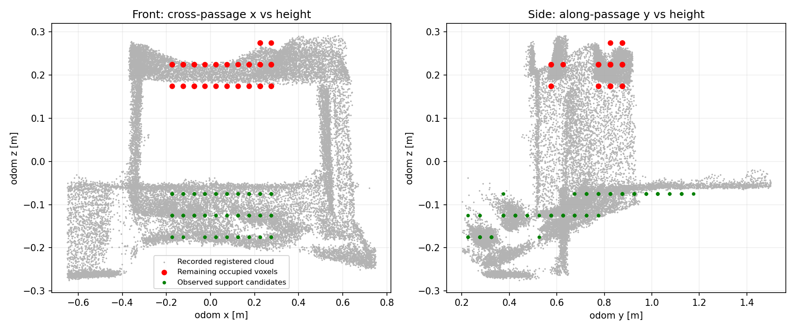

# NUC02：上游坐标与净空检查

## 最新来源核查：剩余 35 个上部占据有原始雷达依据

红色是剩余占据体素，灰色是录制的配准点云，绿色是观测支撑候选。
正面截面显示红点主要落在洞口上沿和侧部连接结构，而不是洞内地面。
这是一项点云形态判断，不是对实物尺寸重新标定。

对全部 35 个体素逐一追溯记录：

| 来源 | 总帧数 | 有直接点命中的体素 | 每体素命中帧数范围 |
|---|---:|---:|---:|
| `/cloud_registered_body` | 387 | 35/35 | 54～387 |
| `/livox/lidar/pointcloud` | 374 | 35/35 | 80～374 |

末尾时刻，配准点云最近命中距末帧 0～0.60 秒，原始点云为约 0.10～1.00 秒。
因此这些占据不是仅由二维膨胀产生，也不是只有过去命中、长期未再次观测的残影。
原始点云采用会话配置外参、最近 IMU 位姿变换，最大时间差约 2.25 ms；未在此脚本中去畸变，
也未把这项检查当成外参标定。原始和配准点云来自同一传感器，不是独立传感器交叉验证。

与同一 XY 格的支撑候选比较，体素中心高度差约 0.25～0.35 m。
**该中心差不等于精确可用净高**：存在 5 cm 体素量化、观测厚度、坡面与标定误差。
不能据此保证 0.32 m 的新车能通过；更不能将 0.70 m 老车的碰撞判断改为通过。

结论：先前低处 124 个占据混入车身体积的问题已经通过支撑面查询分离；
剩余 35 个有反复实测依据，不应为让 Costmap 出洞而直接删除。
生产清障应只在实际车身净空验证成立时解除静态投影假障碍。
当前检查依然处于 shadow，尚未替换生产证据，不存在已完成自动穿洞的结论。

核查工具：`src/rm_perception/sentry_terrain_bridge/scripts/audit_blocked_cloud.py`。
逐体素统计保存在 `docs/assets/passage_nuc_02_upper_provenance.json`。
这次没有修改车高、外参、原始占据阈值或底盘执行链，也没有运行新的仿真。

## 最新：坡转平的连续分段查询（10 月 20 日）

已加入连续的两段支撑模型。转折处高度连续，不把台阶两侧直接拼成可通行坡面；
模型选择采用带复杂度惩罚的比较，避免为这一份录包随意放宽拟合百分比。
仍然逐列查询实际占据支撑和上方已观测自由空间，不用拟合模型填补未知。

另外修复了检查范围：后方额外 0.30 m 辅助拟合条带的异常点不再被当成
当前扫掠体积内部的模型异常；它的残差仍单独报告，并没有从原始地图删除。
NUC02 原来最大残差点位于行进轴 -0.490 m，当前车体扫掠起点为 -0.325 m。

同一 NUC02 录包、同一 0.70 m 车高、同一原探针的末帧对比：

| 项目 | 原水平基准 | 单平面查询 | 连续分段查询 |
|---|---:|---:|---:|
| 低处车身阻挡 | 124 | 8 | **0** |
| 上部车身阻挡 | 35 | 35 | **35** |
| 总阻挡 | 159 | 43 | **35** |
| 缺失支撑查询列 | 140 | 43 | **43** |

这说明本次重建中低处占据可以由支撑面解释，不代表实车已经具备过洞能力。
分段模型中心地面约 -0.0756 m，转折前斜率约 0.1669，转折后约 0.00337。
仍有 3 个支撑点低于模型，坐标分别为 `(0.275,0.525,-0.175)`、
`(0.275,0.775,-0.125)`、`(0.225,0.775,-0.125)`（odom，米）。
这些点显示为 `measured_support_outliers_shadow`；不能仅凭它们断言就是照片上的 2 cm 缺口。

35 个上部占据的 z 分布仍为 0.175 m（14 个）、0.225 m（18 个）、0.275 m（3 个）。
它们没有被地面模型删除。下一项重点应是核对这些点的空间位置、点云来源及与实车净高的关系，
而不是继续放宽地面容差。当前拟合仍有局部不一致，且缺失支撑，所以最终判断仍不通过。

新增状态：`measured_segmented`、`measured_break_along`、`measured_slope_after`、
`measured_model_outliers`、`measured_approach_residual`。
`measured_max_residual` 现在只统计当前扫掠范围，辅助区域使用单独字段。
编译通过，25 项测试通过，已完成 NUC02 点云重建验证。
**继续保持 shadow；这些改进尚未替换生产清障判断，也没有向实车发运动命令。**

## 10 月 20 日：实测坡面查询已实现，当前只作并行对比

新增 `supported_clearance.hpp`，从 ROGMap 的直接观测支撑点估计局部纵向坡面，
按各查询列的实测支撑高度检查上方体积。不填补未知支撑，不将模型残差中的点删除。
平面拟合不成立时仍保留阻挡计数，但 `geometry_pass` 必须为 false。
机器人尺寸、URDF、串口、底盘控制和生产清障许可没有改变。

对 NUC02 原点云及原探针重建的末帧比较（0.70 m 车高）：

| 检查项 | 原水平地面检查 | 实测坡面查询 |
|---|---:|---:|
| 车身内占据体素 | 159 | 43 |
| 其中低处占据 | 124 | 8 |
| 其中上部占据 | 35 | 35 |
| 缺失支撑的查询列 | 140 | 43 |
| 车身内未知体素 | 1087 | 1489 |

两种查询的高度范围不同，未知体素数不能直接当作算法优劣指标。
新的检查框上移后覆盖到原来未检查的上方空间，因此未知体素增多。
这些数值是使用当前本地配置重建的结果，不是改写原录包；原录包记录的阻挡为 161。
本次仍使用录制时的原探针，不把新的 FAST-LIO TF 修正混进该对比。

本次实测模型中心地面约 `-0.0906 m`，纵向斜率约 `0.125`（约 7.1°），
最大支撑点残差约 `0.0769 m`。因此最终模型结果是
`NONPLANAR_OR_AMBIGUOUS_SUPPORT`，不是“净空通过”。
残余低点在 `z=-0.075 m`；上部占据在 `z=0.175/0.225/0.275 m`。
仅凭体素高度不能证明其物理身份，需结合点云位置判断。

### 当前运行行为与查看方式

`rog_map_real.yaml` 已设置 `clearance.support_mode: shadow`。
只在原净空观测节点启用时并行运行，不会单独启动实车、不发布新的通行证据。
`fixed` 可关闭这项并行计算。`clearance.support_max_slope: 0.35` 是模型计算范围，
不是确认了实车爬坡能力，不能作为车辆通行许可。

在 `/terrain/clearance/status` 查看：

- `reason/blocked`：原生产检查。
- `measured_model`：支撑模型是否成立。
- `measured_evaluated`：是否真正查询了新体积。为 0 时计数为 -1，不能理解成无障碍。
- `measured_blocked/measured_body_unknown/measured_support_missing`：并行检查结果。

RViz 的 `/terrain/clearance/markers` 增加三个独立命名空间：
`measured_body_blocked_shadow`、`measured_body_unknown_shadow`、`measured_support_missing_shadow`。
它们只显示查询结果，不表示代价地图已经改变。现有清障证据发布仍用原检查结果。

这轮完成的是坡面查询实现及 NUC02 对比，**不是实车自动清洞交付**。
下一步需要处理坡转平的分段支撑以及残余低处点；不能靠增大平面容差、删除小障碍
或将 0.70 m 老车伪装成低车来使本录包通过。
临时构建与录包对比均成功；净空单元测试 22 项通过（其中包括未知支撑、低横梁、
台阶、箱体和过陡/过期数据的拒绝）。没有覆盖 NUC 的 install。

## 本轮结论（2026-10-19）

先处理 NUC02，不调整膨胀参数，不把原始 `/map` 尚未清除当作修正层失效的证明。
NUC02 的净空检查实际运行了，但没有产出有效清障证据。当前不能宣称隧道已被自动清除。

### 已修复：FAST-LIO 发布车体 TF 漏掉雷达—IMU 外参

滤波器状态 `state_point.pos/rot` 是 IMU 位姿；原实现直接把它当作雷达位姿，
再乘 URDF 的雷达到车体变换。正确计算是：

`T_odom_base = T_odom_imu × T_imu_lidar × T_lidar_base`

修正在 `src/rm_localization/FAST_LIO/src/laserMapping.cpp` 的 `publish_odometry()`。
使用滤波器自己的 `offset_R_L_I/offset_T_L_I`，没有修改 URDF 或猜测实车标定。
保留 `/Odometry` 的历史 IMU 位姿数据语义，避免把依赖它的 ROGMap 点云变换再次偏移。
注意这个历史话题的 `child_frame_id=livox_frame` 命名仍不严格；本轮没有做跨模块话题迁移。

对 NUC02 387 组完全同时间戳的 `/Odometry` 与 TF 检查：

- 录制 TF 与旧公式一致，最大矩阵误差约 `2.22e-16`。
- 按该次配置的外参计算，修正后 base_link 的 z 增加约 `0.0441 m`。
- 修正后通过 URDF 还原的雷达位姿，与点云使用的雷达位姿闭合，误差约 `1.39e-17`。
- FAST-LIO 在临时构建目录编译通过；没有覆盖本机 install，没有在 NUC 部署。

复查工具：`src/rm_perception/sentry_terrain_bridge/scripts/audit_nuc02_frames.py`。
它只读取录包，不发布 ROS 消息。所用外参是会话配置假设，不是从 bag 恢复的参数快照。

### 尚未解决的主要问题：把机器人脚下的平面延伸到上坡洞内

原探针地面 `z≈-0.483 m`。重建 ROGMap 中，洞内候选支撑主要在
`-0.175～-0.075 m`。因而检查框把坡面的一部分纳入了“车身占据”。
这不是 4.4 cm 的 TF 修正能够消除的差距；也不能只凭这些高度断言实车安装高度错误。
机器人脚下地面与洞内坡面本来就可能不同。

原重建的 159 个车身阻挡体素中，124 个位于低处，35 个位于上部。
只将高度从 0.70 改为 0.32 m、仍使用原地面，低处 124 个阻挡仍在。
这是反事实检查，不是许可，且重建与原录制的 161 个阻挡略有差异。

下一项实质修复应是沿行进方向使用已观测支撑面，联合检查坡度、支撑缺失和上方净空，
而不是把整个地面抬高一个常数或忽略所有低点。缺失支撑、真实凸起和低横梁仍需保留。
当前支撑面估计仅用于诊断，尚未接入生产通行证据；老车 0.70 m 的物理净高限制仍存在。

## NUC 部署注意

这次更改需要重新编译 `fast_lio`，只编译感知桥接包不会生效。
先停车检查 TF、原始点云与机器人模型对齐；不要用旧录包里的 TF 评价新发布器是否生效。
本轮修正不等于隧道通行闭环完成，也不建议现在仅为这一项修正重新做整场实车测试。
