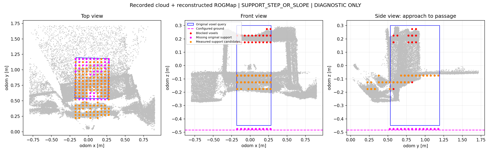
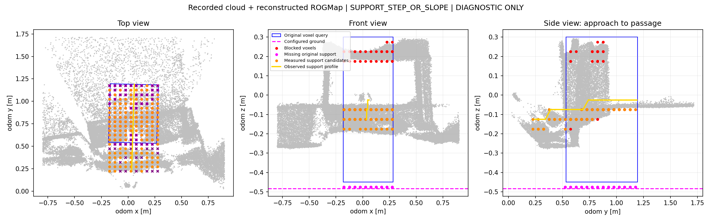

# passage_nuc_02：只读支撑面诊断

2026-10-19。本轮没有启用自动地面修正、Costmap 清障或底盘运动。

后续修正：NUC03 录包发现三维坐标关联先于净空查询被拒绝，不能将本文的坡面诊断视为整个清障链路的主要原因。当前优先级和地图/规划数值核查见 [NUC03 规划与清障核查](passage_nuc_03_规划与清障核查.md)。

## 实测录包得到的结果



灰色：录制的 IMU-body 点云按里程计变换到 odom 后累积。
蓝框：原始车体体素检查范围。红色：离线重建的阻塞体素。
紫色：原基准下缺失的支撑体素。橙色：新估计器找到的已观测支撑候选。
图是 odom 坐标；高度不是离地高度。新候选未通过时，不绘制一个假装有效的新检查框。

原始假定地面约为 odom z=-0.483 m。新候选分布在 -0.175、-0.125、-0.075 m 三层（体素中心），不是同一个平面：

| 统计 | 本次末帧 |
| --- | ---: |
| 支撑采样位置 | 200 |
| 没有满足条件的支撑观测 | 58 |
| 多层候选歧义 | 0 |
| 与入口参考高度差超过一个 5 cm 体素 | 69 |
| 原检查框阻塞体素 | 159 |
| 原检查框内部未知体素 | 1087 |
| 原地面支撑缺失 | 140 |

新诊断为 `SUPPORT_STEP_OR_SLOPE`，移动后净空检查为 `NOT_EVALUATED`。
这意味着扫描到的支撑候选不满足当前近似平面模型，**不能据此断言现场一定存在可行驶坡道，也不能把所有候选都当作真实地面**。可能包含坡面、底板、物体或观测误差，需要与实际搭建结构核对。

## 现场照片复核

用户提供的现场照片确认洞口下方有坡面，坡面与平面连接处靠右侧有一处估计约 2 cm 的缝隙。这里的 2 cm 是缝宽估计，照片没有给出缝深、落差，也不能证明缝隙横跨整个车宽。

真实坡面使 `SUPPORT_STEP_OR_SLOPE` 有了现场依据，但单张照片仍不能解释录包中全部 58 个未观测支撑位置和 69 个高度不连续位置。当前体素分辨率为 5 cm，不能用一个体素的分类可靠量出 2 cm 的缝宽；缝附近的未知或缺失支撑仍应保留为不确定，不自动清障。

下一步应沿预期车轮接触带估计分段坡面、接缝和可观测支撑，并与独立的车体净空检查合并。局部接缝不应仅因矩形车体投影里某一列缺少地面就判定整条通道必然不可走，但也不能把未观测格当成有支撑。实际越缝能力还取决于缝深、车轮尺寸和底盘离地间隙，待新车尺寸确定后再评估入口通行许可。

目前增加了只读坡面剖面显示：RViz 中黄色折线是沿探针行进方向逐行取到的已观测支撑中位高度，线段遇到整行无观测会中断；紫色点是缺少支撑观测的采样 XY 位置，点的高度仅采用探针基准，**不代表缝深**。`/terrain/clearance/status` 新增 `support_profile_rows`、`support_max_adjacent_row_delta` 和 `support_max_lateral_row_spread`。这些量用于区分坡面、横向高差与遮挡，不构成通行判定；本版仍不会因坡面候选而清除 Costmap。



在同一份 NUC 录包上重建，新剖面有 20 行，相邻已观测行的最大高度变化为 5 cm，行内最大横向高度差也为 5 cm；58 个支撑采样位置未观测。图中的紫色叉号分布在探针近端和远端多个位置，不能仅凭现场右侧约 2 cm 缝隙解释。原阻塞计数仍为 159，`relocated_diagnostic=NOT_EVALUATED`，所以这轮没有产生可通行证据。

原始录包末帧阻塞计数为 161，本轮重建为 159；未知和支撑缺失计数一致。这是近似重建，不是原始 ROGMap 快照逐体素复现。使用了当前本地 ROGMap YAML、该次 FAST-LIO 外参配置和录制时间节奏，未录制的 NUC 参数无法完全还原。

## 本轮实现

- `support_surface.hpp`：只读支撑候选估计器，从车体扫掠范围前方 0.30 m 的条带向前检查。
- 候选必须是新鲜的实测占据体素，且其上方至少 0.10 m、至少两层体素均为实测自由。未知不当作自由。
- 诊断搜索范围为原地面基准下方 0.10 m 至上方 0.60 m；这是有限搜索带，不是已标定地面。
- 第一版只接受近似水平连续支撑面。多层、缺观测、超过一个体素高度变化分别报告；没有放宽车体净空和原支撑验证。
- `clearance_observer.hpp` 新增橙黄色候选、诊断状态；只有完整候选成立才显示蓝色新框并运行独立净空对照。
- 独立对照结果不赋值给原探针、原验证结果或多帧确认，不进入清障证据与通行许可。

完成相关包构建及 18 项受影响测试。本轮重点证据是上述真实录包结果，而不是测试数量。尚未完成生产地面自动适配、坡道/台阶可通行判断和 NUC 在线复测。

## NUC 上查看，不必重新做整套实验

同步修改后编译 `sentry_terrain_bridge`。在原 `rog_map_real.yaml` 的 `sentry_terrain.ros__parameters` 下增加：

```yaml
    clearance.support_diagnostic: true
```

保持原入口的 `enable_motion:=false`，重启感知节点（此开关在构造时读取，不是运行时动态参数）。RViz 添加 `MarkerArray`，话题 `/terrain/clearance/markers`。用 Publish Point 指向洞口后观察橙黄色支撑候选及诊断文本；原红色阻塞和紫色缺支撑仍保留对照。

默认 `clearance.support_diagnostic=false`。本轮没有替你改变实车尺寸、外参、固定 ground_z_offset 或生产清障开关。

## 可重复分析与后续判断

工具：`src/rm_perception/sentry_terrain_bridge/scripts/reconstruct_support_bag.py`，使用 `--help` 查看输入。它是针对此次录包的重建工具，明确固定本次 0.70 m 车高、-0.23 m 地面偏移和 FAST-LIO 外参，不应直接当成通用部署标定工具。
只启动 terrain_node，在单独的本机 ROS 域发布点云、里程计、时钟和探针；不运行 Nav2，不发布速度。必须选择与实车不相同的域。输出目录要求新建，避免覆盖已有证据。

后续先核对真实洞口下方是否有底板/坡面及其高度变化。如果确有变化，需要分段支撑曲面与底盘爬坡/越阶能力，而不是把平面容差调大；若现场实际是平地，则先排查点云坐标、遮挡和自身回波。只有可靠支撑面及真实车体净空同时通过，才把新基准接入生产证据链。

附：[原始诊断文本](assets/passage_nuc_02_support_status.txt)、[重建假设](assets/passage_nuc_02_support_assumptions.json)。
