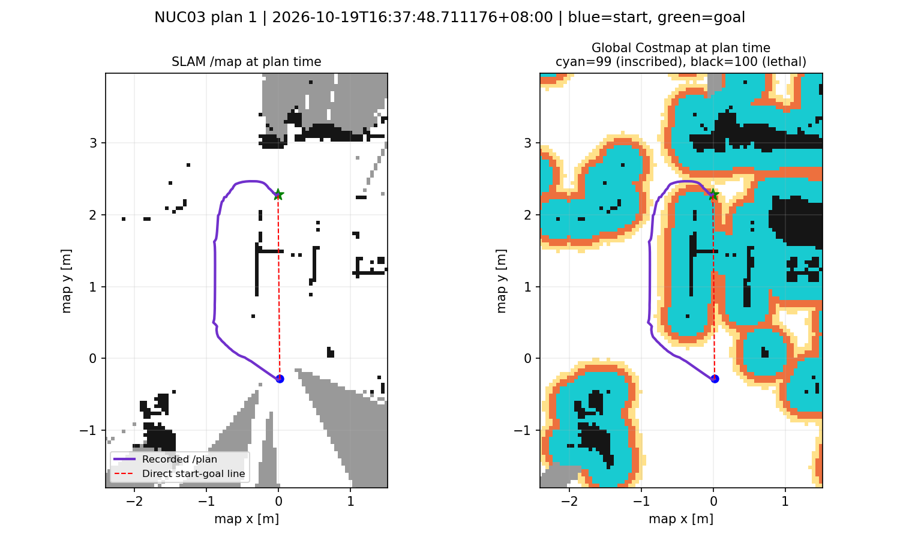

# passage_nuc_03：规划输入、清障证据与车高核查

2026-10-19。输入：`/home/zst/passage_nuc_03/passage_nuc_03_0.db3`，约 97.3 秒。直接反序列化录包中的地图、路径、状态与 TF；没有重放控制指令、改车高或改写原包。

## 结论

本次没有完成三维验证，也没有发生经过证据授权的静态清障。最早能明确定位的阻断是通道记忆对 `map→odom` 的平面旋转限制：真实 TF 含倾斜，接口拒绝关联，探针协调器持续等待。NUC03 的 485 条净空状态全部为 `NO_PROBE`，因此不能把本次拒绝归因于车高或坡面支撑。

之前针对 NUC02 的支撑面诊断只能说明固定水平支撑假设存在问题，不能据此断言坡面或 2 cm 缝隙是整个清障链路的主要原因。现在优先修复三维坐标关联，再验证真实车高、地面基准和坡面净空。

## 录包证据

| 项目 | 结果 |
| --- | --- |
| 净空状态 | 485 条，全为 `NO_PROBE`，记录车高均为 0.70 m |
| 探针状态 | 483 条，全为 `WAIT_FRESH_MAP_GOAL_POSE_AND_ASSOCIATION` |
| 地图关联拒绝 | 343 条 `INVALID_PLANAR_QUATERNION` |
| `map→odom` 倾斜 | 最大绝对 roll 约 12.66°，pitch 约 1.16° |
| 真实净空证据 `/terrain/clearance/verified_segment` | 0 条 |
| 清障掩膜 `/passage/verified_static_clearing` | 471 帧，所有帧有效清障格数均为 0 |
| 入口许可 `/passage/fresh_permit` | 0 条 |
| Publish Point | 16:37:28.939，坐标系 map |
| 全局路径 | 3 条，16:37:48.711、16:37:59.632、16:38:00.661 |

接口拒绝点位于 `scripts/live_memory_shadow.py` 的 `yaw_of()`：四元数 x 或 y 分量绝对值大于 0.01 即拒绝。`map_context()` 对 `map→odom` 使用了这个函数。`progressive_probe_coordinator.py` 也有平面限制，并只按平移加 yaw 变换探针。不能只删检查：后续坐标与区域投影公式也必须正确处理三维旋转。该现象说明接口的假设不适配此次 TF，不能直接认定 TF 发布错误。

## Nav2 读取什么

本工程配置的 `GridBased` 为 `nav2_navfn_planner/NavfnPlanner`。NavFn 通过 `costmap_ros->getCostmap()` 获取代价地图，并将 `costmap_->getCharMap()` 交给搜索器。它使用规划服务器持有的融合后全局 Costmap；`/global_costmap/costmap` 是该地图的发布快照，不是规划器另行订阅的原始地图。

来源：[Nav2 Humble NavFn 源码](https://github.com/ros-navigation/navigation2/blob/humble/nav2_navfn_planner/src/navfn_planner.cpp)。

`StaticCorrectionLayer` 按设计只修正全局 Costmap，不写回 SLAM `/map`。原图保持障碍不能单独证明清障失败；本包失败的直接证据是掩膜全零，以及全局图中静态障碍实际未被清除。

## 对齐路径时刻后，Costmap 仍有障碍

下面使用每条路径发布之前最近的完整地图快照，按 map 坐标比较；快照不等于规划瞬间的内部内存。

| 路径时刻 | 全局快照早于路径 | 原图障碍格 | 这些格在全局图中仍为 100 |
| --- | ---: | ---: | ---: |
| 16:37:48.711 | 0.480 秒 | 1809 | 1809 |
| 16:37:59.632 | 0.001 秒 | 1809 | 1809 |
| 16:38:00.661 | 0.426 秒 | 1809 | 1809 |

起点到终点的直连线在 map 坐标约 `(0.002, 1.48)` 至 `(0.002, 1.50)` 仍经过发布值 100 的障碍，并经过值 99 的内切膨胀区域。已有路径绕行与全局 Costmap 相符。

左侧为原图，右侧为全局 Costmap；紫线是录到的路径，红色虚线是起终点直连线。右图青色为发布值 99，黑色为 100。图中颜色是本次分析明确定义的，不依赖 Foxglove 的显示方案。

用户提供的第二张截图是 16:38:08，路径截图是 16:37:49，相差约 19 秒；第二张同时显示了 `/map`、局部和全局 Costmap。叠加和显示配色不能替代逐格数值核查。

## 车高仍需考虑，但不同录包要分开

NUC03 尚无探针，因此 0.70 m 并未实际进入净空查询。NUC02 的上次离线重建有 159 个阻塞体素；保持原地面基准约 odom z=-0.483 m 不变，把查询高度范围按 0.32 m 裁剪，仍包含 124 个阻塞体素。被排除的是上方 35 个体素，下方 124 个仍在范围内。

这只是同一重建快照的高度范围对照，不是 0.32 m 实车通过测试；它说明车高会影响查询，但单独降低车高不能解决旧地面基准导致的下方阻塞。原录包阻塞数 161 与重建 159 的差异仍保留，不能把近似重建当成逐体素原样复现。

## 下一步实施顺序

1. 修复 map/odom 三维变换在探针、证据区域和记忆关联中的一致处理；保留无效四元数检查，不能简单删除平面限制后继续使用二维公式。
2. 用 NUC03 直接验证已发布的观察点能生成探针，状态从 `NO_PROBE` 进入实际三维查询，并检查变换后的区域位置。
3. 对 NUC02/03 检查正确地面基准下的实际车高、坡面与顶部阻塞，必要的虚拟尺寸对照只能用于效果分析。
4. 最后核对同一时刻的有效证据、非零清障掩膜、最终 Costmap 改变与新的 `/plan`。原始 `/map` 保留作为对照。

本次交付为录包诊断与证据图，尚未修复三维变换接入，也未宣称自动清障或实车过洞通过。
